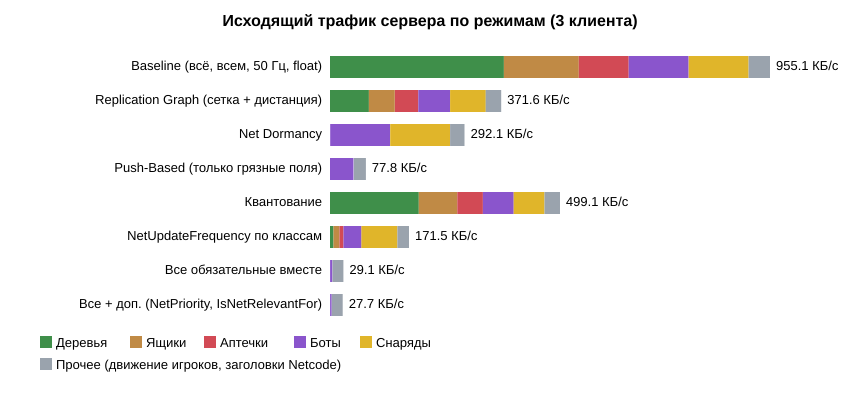

# Базовый профиль трафика репликации

## 1. Общие сведения

| Параметр | Значение |
|---|---|
| Проект | `Practice5_Replication`: прототип практики 4 (Listen Server, предсказание движения) + нагруженная арена |
| Команда | Пройдаков Дмитрий   Петров Артем   Бухальцев Павел |
| Движок | **Unity 6000.6.0f1** (URP). Методичка написана для Unreal Engine, работа выполнена на Unity. Соответствие понятий приведено в разделе 2 |
| Сетевой стек | Netcode for GameObjects **2.13.3**, Unity Transport 2.6 |
| Исходные данные | [`profiles/netprofile_baseline_server.csv`](profiles/netprofile_baseline_server.csv) (посекундно), [`profiles/netprofile_baseline_server.json`](profiles/netprofile_baseline_server.json) (итог), CSV/JSON трёх клиентов там же |

## 2. Инструменты (Unreal → Unity)

| В методичке (Unreal) | В проекте (Unity) |
|---|---|
| `netprofile enable` / `netprofile disable` | [`TrafficProfiler.Enable / Disable`](../Assets/Prac5/Scripts/Runtime/TrafficProfiler.cs): клавиша **F5** в игре или автоматически в режиме замера. Пишет посекундный CSV и итоговый JSON |
| Network Profiler (просмотр `.nprof`) | [`tools/make_report.py`](../tools/make_report.py): таблицы и графики по CSV/JSON. Для живого просмотра в редакторе можно пользоваться модулем *Network Profiler* из Multiplayer Tools |
| Счётчик исходящих байт `UNetDriver` | [`CountingTransport`](../Assets/Prac5/Scripts/Runtime/CountingTransport.cs): наследник `UnityTransport`, считает каждый пакет Netcode, переданный транспорту |
| Байты по акторам (вкладка Actors) | [`RepStats`](../Assets/Prac5/Scripts/Runtime/RepStats.cs): сервер репликации считает байты каждой записи по классу актора |

**Что считается трафиком.** «Исходящий трафик сервера» — это вся полезная нагрузка, которую Netcode
отдаёт транспорту, со всеми заголовками Netcode: репликация акторов, RPC движения игроков из практики 4,
служебные сообщения. Заголовки UTP/UDP/IP (≈ 30–40 байт на UDP-пакет) в эту цифру не входят. Хост сам
себе по сети ничего не отправляет, поэтому весь трафик идёт трём удалённым клиентам.

## 3. Нагруженная сцена

Сцена [`Prac5_Replication.unity`](../Assets/Prac5/Scenes/Prac5_Replication.unity) собирается меню
**Prac5 → Собрать сцену и префабы**. Арена 150 × 150 м, акторы расставляются детерминированно (seed = 5)
в [`ArenaDirector`](../Assets/Prac5/Scripts/Runtime/ArenaDirector.cs). Набор акторов соответствует
механикам из описания игры: разрушаемые укрытия, аптечки, противники, снаряды.

| Класс | Кол-во | Поведение на сервере | Что меняется |
|---|---|---|---|
| Дерево (`Tree`) | 70 | декорация, стоит на месте | ничего |
| Ящик-укрытие (`Crate`) | 30 | получает урон от снарядов (25 HP за попадание), при 0 HP разрушается и через 8 с восстанавливается | HP, активность |
| Аптечка (`Pickup`) | 20 | игрок подбирает её, проходя рядом, через 6 с она появляется снова. Половина лежит на маршрутах игроков | активность |
| Бот (`Bot`) | 24 | ходит между случайными точками (3,5 м/с), останавливается, раз в 1,5–3,5 с стреляет в ближайший ящик или игрока в радиусе 14 м | позиция, поворот, скорость |
| Снаряд (`Projectile`) | 24 (пул) | летит по прямой 18 м/с до 1,2 с или до попадания в ящик | позиция, скорость, активность |
| **Итого** | **168** | | |

Плюс 4 персонажа игроков из практики 4. Их движение реплицируется своими RPC, в эти 168 акторов они не входят.

**Реплицируемое состояние актора** ([`EntityState`](../Assets/Prac5/Scripts/Runtime/RepTypes.cs)):
позиция (`Vector3`), поворот по Y (`float`), скорость (`Vector3`), HP (`float`), флаг активности
и номер появления (по байту).

## 4. Базовая репликация: «всё, всем, всегда»

Режим `Optimizations = None` в [`ReplicationServer`](../Assets/Prac5/Scripts/Runtime/ReplicationServer.cs).
Это та же схема, что и в исходном протоколе проекта (практика 1: сервер рассылает полное состояние мира
50 раз в секунду):

* каждый из 168 акторов **каждый сетевой тик (50 Гц)** попадает в рассылку;
* **каждому клиенту**, без проверки дистанции и релевантности;
* **всё состояние целиком**, без учёта того, что поменялось;
* без сжатия: позиция и скорость по 3 × `float`, поворот и HP по `float`;
* ненадёжный канал (`Unreliable`), сообщения нарезаются по ≤ 1100 байт, чтобы не было фрагментации.

Одна запись актора: `id` (varint, 1–2 байта) + маска полей (1 байт) + 34 байта данных ≈ **37 байт**.

## 5. Условия замера

| Параметр | Значение |
|---|---|
| Топология | Listen Server (хост с собственным персонажем) + **3 клиента**, все на одном ПК, loopback 127.0.0.1 |
| Процессы | headless-билд (`-batchmode -nographics`), [`tools/run_profile.ps1`](../tools/run_profile.ps1) |
| Сценарий | все 4 игрока на автопилоте ([`Autopilot`](../Assets/Prac5/Scripts/Runtime/Autopilot.cs)): бегут по концентрическим окружностям радиусом 10 / 30 / 50 / 68 м (хост — по ближней). Боты, снаряды, разрушение ящиков и подбор аптечек идут в реальном времени |
| Прогрев | 8 с после подключения всех трёх клиентов (начальная синхронизация в замер не входит) |
| Запись | 60 с, одна строка CSV в секунду |
| Тикрейт сервера | 50 Гц (`NetworkConfig.TickRate`, как в практике 4) |

## 6. Результаты базового профиля

### Общий трафик

| Метрика | Значение |
|---|---|
| Исходящий трафик сервера, среднее | **955,1 КБ/с** (≈ 7,6 Мбит/с) |
| Минимум / максимум за секунду | 949,7 / 972,1 КБ/с |
| из них репликация акторов | 909,5 КБ/с (95 %) |
| прочее: движение игроков (практика 4) и заголовки Netcode | 46,4 КБ/с |
| На одного клиента | ≈ 318 КБ/с (клиент принимает 305,5 КБ/с сообщений репликации) |
| Передач пакетов транспорту | 1 022 в секунду |
| Записей акторов | 25 204 в секунду = 168 акторов × 50 Гц × 3 клиента |
| Частота обновления каждого актора | 50 Гц у всех классов, включая неподвижные деревья |
| Релевантно акторов на клиента | 168 из 168 |
| Акторов, обработанных сервером репликации | 8 401 в секунду (168 × 50) |
| Время кадра репликации на сервере | 0,199 мс на тик |

Трафик почти не меняется во времени (колебания ±1,5 %): объём определяется числом акторов, а не тем,
что на арене происходит.

### «Тяжёлые» акторы

| Класс | КБ/с | Доля | Сколько из этого полезно |
|---|---|---|---|
| **Деревья** | **377,4** | **39,5 %** | 0 %: деревья никогда не меняются, но 70 штук × 50 Гц × 3 клиента × 37 байт |
| **Ящики** | **162,6** | **17,0 %** | < 1 %: HP меняется только при попадании, несколько раз в минуту |
| Боты | 130,1 | 13,6 % | основная полезная нагрузка, но и тут 50 Гц избыточно для ходьбы 3,5 м/с |
| **Снаряды** | **130,1** | **13,6 %** | мало: большая часть пула неактивна, но тоже рассылается. Активный снаряд летит по прямой, и клиент мог бы посчитать его сам |
| Аптечки | 108,4 | 11,4 % | < 1 %: меняется только флаг активности при подборе |
| Прочее | 46,4 | 4,9 % | движение игроков + заголовки |

## 7. Выводы по базовому профилю

1. **Статичные акторы — главный источник трафика.** Деревья, ящики и аптечки дают 68 % трафика,
   хотя почти ничего не меняют. Это кандидаты на **Net Dormancy** и **push-based** репликацию.
2. **Каждый клиент получает весь мир.** Игрок видит область примерно 30–40 м вокруг себя, а получает
   все 168 акторов на 150 × 150 м. Нужна релевантность по дистанции (**Replication Graph, Grid
   Spatialization**).
3. **Одинаковая частота 50 Гц для всех** избыточна для декораций и медленных ботов (**NetUpdateFrequency**).
4. **Неэффективная упаковка.** Позиция занимает 12 байт с точностью до микрометров на арене в 150 м,
   поворот — 4 байта (**квантование**: `FVector_NetQuantize100`/`NetQuantize10`).
5. Трафик растёт линейно с числом акторов и с числом клиентов: при 4 клиентах ≈ 1,3 МБ/с.

Оптимизации и повторный профиль: [Replication_Optimization.md](Replication_Optimization.md).
