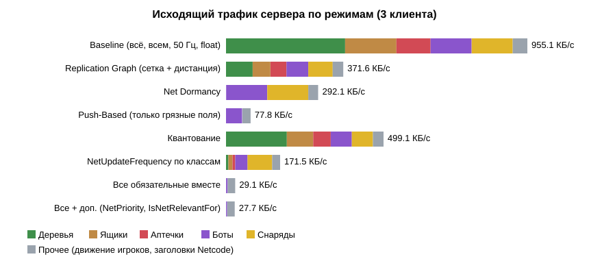
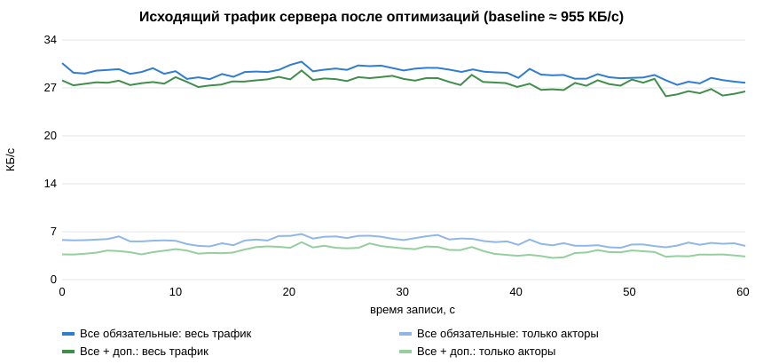

# Оптимизация репликации: отчёт

## 1. Общие сведения

| Параметр | Значение |
|---|---|
| Проект | `Practice5_Replication`: нагруженная арена «Битвы жердяев» на прототипе практики 4 |
| Команда | Пройдаков Дмитрий <br> Петров Артем <br> Бухальцев Павел |
| Движок | **Unity 6000.6.0f1**. Методичка написана для Unreal Engine; для каждой техники ниже указан аналог в Unreal |
| Сетевой стек | Netcode for GameObjects **2.13.3**, Unity Transport 2.6 |
| Базовый профиль | [Replication_Baseline.md](Replication_Baseline.md) |
| Исходные данные | [`profiles/`](profiles/): посекундные CSV и итоговые JSON сервера и трёх клиентов для каждого режима, сводка [`profiles/summary.md`](profiles/summary.md) |

**Итог:** при тех же 168 акторах, тех же 3 клиентах и том же сценарии исходящий трафик сервера снизился
с **955,1 до 29,1 КБ/с (−97,0 %)**. Сама репликация акторов снизилась с 909,5 до 5,4 КБ/с (−99,4 %).
Оставшиеся ~24 КБ/с почти целиком приходятся на движение игроков из практики 4, которое в этой работе
не оптимизировалось. Каждая из пяти обязательных техник проверена и по отдельности: даже по одной они
снижают трафик на 48–92 %.

## 2. Как устроена репликация в проекте

В Netcode for GameObjects нет готовых Replication Graph, Net Dormancy и NetUpdateFrequency для отдельных
объектов, поэтому слой репликации акторов написан вручную по схеме `UNetDriver` / `UReplicationGraph`:

```
 ArenaDirector.OnTick (50 Гц, сервер)
   1. симуляция: боты, снаряды, урон ящикам, подбор аптечек
      └─ изменения состояния идут через ReplicatedEntity.SetXxx → помечают поле «грязным» (DirtyMask)
   2. ReplicationServer.Replicate(now)
      ├─ по каждому актору: спит ли (Dormancy)? пора ли обновлять (NetUpdateFrequency)?
      │                     какие поля отправлять (Push: только грязные, иначе все)
      └─ по каждому клиенту:
           ├─ релевантность: ячейки сетки вокруг игрока → NetCullDistance → IsNetRelevantFor
           │   актор вошёл в зону → «открыть канал» (полное состояние), вышел → запись Close
           ├─ (Priority) сортировка по NetPriority, бюджет байт на тик
           └─ сериализация записей (RepWire, с квантованием или без) → сообщения ≤ 1100 байт
 Клиент: ReplicationClient → ReplicatedEntity.ApplyRecord → интерполяция (снаряды — экстраполяция)
```

| Файл | Роль |
|---|---|
| [`ReplicationServer.cs`](../Assets/Prac5/Scripts/Runtime/ReplicationServer.cs) | серверный кадр репликации, все оптимизации |
| [`SpatialGrid.cs`](../Assets/Prac5/Scripts/Runtime/SpatialGrid.cs) | сетка Grid Spatialization |
| [`RepTypes.cs`](../Assets/Prac5/Scripts/Runtime/RepTypes.cs) | политики классов: NetUpdateFrequency, NetCullDistance, Dormancy, NetPriority |
| [`ReplicatedEntity.cs`](../Assets/Prac5/Scripts/Runtime/ReplicatedEntity.cs) | состояние актора, push-based пометка полей, клиентское сглаживание |
| [`RepWire.cs`](../Assets/Prac5/Scripts/Runtime/RepWire.cs) | формат записи и квантование |

Оптимизации — независимые флаги `RepOptimizations`. Их можно переключать на хосте прямо в игре (HUD)
или задавать при запуске (`-p5opt`), поэтому каждая техника измерена и отдельно, и в сочетании.

## 3. Применённые техники

### 3.1. Replication Graph: Grid Spatialization (обязательная)

*Unreal:* `UReplicationGraphNode_GridSpatialization2D` + `NetCullDistanceSquared`.

* Мир разбит на ячейки **20 × 20 м**. Каждый актор лежит в своей ячейке, движущиеся переходят между
  ячейками при смене позиции (`SpatialGrid.Update`).
* Для клиента перебираются только ячейки в радиусе максимальной дистанции отсечения от его персонажа,
  затем проверяется дистанция класса (таблица в 3.6).
* **Гистерезис 10 %:** уже видимый актор закрывается только на 1,1 × дистанции, поэтому на границе
  зоны не возникает постоянного открытия и закрытия.
* Актор входит в зону: клиент получает полное состояние («открытие канала»). Актор выходит: короткая
  запись `Close` (2–3 байта), и клиент прячет его.

### 3.2. Net Dormancy (обязательная)

*Unreal:* `NetDormancy = DORM_Initial` / `DORM_DormantAll` + `FlushNetDormancy()`.

* Деревья, ящики и аптечки — «спящие» классы (`Dormant = true`). Спящий актор **не обрабатывается
  сервером репликации вовсе**: ни сравнения, ни сериализации.
* «Пробуждение» (аналог `FlushNetDormancy`) происходит автоматически, когда геймплей меняет состояние:
  попадание снаряда в ящик (`SetHp`), разрушение и восстановление, подбор аптечки (`SetActive`).
  Актор отправляет изменения и снова засыпает.
* Деревья не меняются никогда, поэтому фактически живут в `DORM_DormantAll`: после первой отправки
  о них не передаётся ни байта, пока игрок не уйдёт и не вернётся в зону релевантности.

### 3.3. Push-Based Replication (обязательная)

*Unreal:* `MARK_PROPERTY_DIRTY_FROM_NAME` + `bIsPushBased = true`.

* Состояние актора меняется только через сеттеры `SetPosition / SetYaw / SetVelocity / SetHp / SetActive`.
  Сеттер сравнивает значение и **сам помечает поле грязным** (`DirtyMask`).
* На каждого клиента копится маска неотправленных полей (`Pending`); в запись идут только они, а маска
  записывается перед полями (1 байт).
* **Снаряд** летит по прямой: сервер двигает его через `SetPositionSilently`, без пометки.
  Клиент получает позицию и скорость один раз при выстреле и дальше считает полёт сам (экстраполяция).
  Повторно снаряд отправляется только при попадании или исчезновении. Это аналог `ProjectileMovement`
  с репликацией начального движения.
* Дельты не повторяются в каждом тике, поэтому в режимах с push, dormancy или grid сообщения идут
  каналом `ReliableSequenced`. Это аналог надёжной доставки свойств в Unreal. В baseline полное состояние
  уходит каждый тик, и там достаточно `Unreliable`.

### 3.4. Квантование (обязательная)

*Unreal:* `FVector_NetQuantize100`, `FVector_NetQuantize10`, сжатие `FRotator`.

| Поле | Без квантования | С квантованием | Точность |
|---|---|---|---|
| Позиция | 3 × `float` = 12 Б | 3 × `int16`, шаг 1 см (аналог `NetQuantize100`) = 6 Б | ±0,5 см в пределах ±327 м (арена 150 м) |
| Скорость | 3 × `float` = 12 Б | 3 × `int16`, шаг 0,1 м/с (аналог `NetQuantize10`) = 6 Б | ±0,05 м/с |
| Поворот (yaw) | `float` = 4 Б | 1 байт | 1,4° |
| HP | `float` = 4 Б | 1 байт | 1 HP (HP целое 0–100) |
| **Полная запись** | **≈ 37 Б** | **≈ 19 Б** | |

### 3.5. NetUpdateFrequency по классам (обязательная)

*Unreal:* `AActor::NetUpdateFrequency`.

Актор рассматривается не чаще своей частоты. Изменения между обновлениями не теряются: они копятся
в маске и уходят в ближайшее обновление.

### 3.6. Итоговые политики классов

| Класс | NetUpdateFrequency | NetCullDistance | Dormancy | NetPriority |
|---|---|---|---|---|
| Дерево | 1 Гц | 45 м | `DORM_Initial` (на деле `DormantAll`) | 0,5 |
| Ящик | 4 Гц | 55 м | `DORM_Initial` + flush при уроне | 1,0 |
| Аптечка | 4 Гц | 55 м | `DORM_Initial` + flush при подборе/появлении | 1,5 |
| Бот | 15 Гц | 60 м | — | 3,0 |
| Снаряд | 30 Гц | 50 м | — | 3,0 |
| *Baseline (все классы)* | *50 Гц* | *∞* | *—* | *—* |

Камера в игре видит примерно 30–40 м вокруг персонажа, поэтому дистанции отсечения взяты с запасом:
акторы появляются за краем экрана, а не на глазах у игрока.

### 3.7. Дополнительное задание

**Собственная функция релевантности** (`ReplicationServer.IsNetRelevantFor`, аналог `AActor::IsNetRelevantFor`):
сначала проверяется дистанция класса, затем направление взгляда игрока (`MoveState.Facing` из практики 4).
Актор, который находится **за спиной** (угол больше ≈ 105°) и дальше 15 м, релевантен только
на половине дистанции отсечения. Исключение — снаряды: угроза со спины важна всегда.

**Приоритизация (NetPriority)** (`ReplicationServer.SendToConnection`): кандидаты на отправку сортируются
по `NetPriority класса × время с последней отправки этому клиенту × 2 (если ближе 15 м)`. Действует
бюджет **1000 байт на клиента за тик** (≈ 49 КБ/с). Что не поместилось, остаётся в очереди и с каждым
тиком поднимается в приоритете, как в `UNetDriver::ServerReplicateActors`. Поэтому враги и снаряды
(приоритет 3) при нехватке канала обновляются раньше декораций (0,5).

## 4. Условия повторного замера

Те же, что и в базовом профиле ([Replication_Baseline.md, раздел 5](Replication_Baseline.md#5-условия-замера)):
тот же билд, хост + 3 клиента на loopback, тот же seed арены, тот же маршрут автопилота, прогрев 8 с,
запись 60 с. Меняется только аргумент `-p5opt`. Все режимы сняты одним скриптом
[`tools/run_profile.ps1`](../tools/run_profile.ps1).

## 5. Результаты: до и после

### 5.1. Главная таблица

| Метрика | До (baseline) | После (все обязательные) | Изменение | После (все + доп.) | Изменение |
|---|---|---|---|---|---|
| **Исходящий трафик сервера, КБ/с** | **955,1** | **29,1** | **−97,0 %** | **27,7** | **−97,1 %** |
| в т. ч. репликация акторов, КБ/с | 909,5 | 5,4 | −99,4 % | 4,0 | −99,6 % |
| в т. ч. прочее (движение игроков, заголовки Netcode), КБ/с | 46,4 | 23,7 | −49 % | 23,8 | −49 % |
| Трафик на одного клиента, КБ/с | 318,4 | 9,7 | −97,0 % | 9,2 | −97,1 % |
| Клиент принимает репликации акторов, КБ/с | 305,5 | 2,0 | −99,3 % | 1,5 | −99,5 % |
| Реплицируемых акторов на сервере | 168 | 168 | — | 168 | — |
| **Релевантно акторов на клиента** (среднее) | **168,0** | **62,4** | −62,9 % | **47,1** | −72,0 % |
| Записей акторов в секунду (все клиенты) | 25 204 | 593 | −97,6 % | 435 | −98,3 % |
| Передач пакетов транспорту в секунду | 1 022 | 290 | −71,6 % | 291 | −71,5 % |
| Акторов, обработанных сервером, в секунду | 8 401 | 1 085 | −87,1 % | 1 085 | −87,1 % |
| Время кадра репликации на сервере, мс | 0,199 | 0,100 | −50 % | 0,128 | −36 % |

Колебания по секундам: baseline 949,7–972,1 КБ/с, «все обязательные» 27,4–30,7 КБ/с,
«все + доп.» 25,8–29,5 КБ/с.





### 5.2. Вклад каждой техники по отдельности

Каждая техника включалась одна, все остальные условия как в baseline.

| Режим | Трафик сервера, КБ/с | Изменение | Релевантно на клиента | Акторов обработано/с | Кадр репликации, мс | За счёт чего |
|---|---|---|---|---|---|---|
| Baseline | 955,1 | — | 168,0 | 8 401 | 0,199 | — |
| Replication Graph | 371,6 | **−61,1 %** | 62,4 | 8 399 | 0,199 | клиент получает только акторы в радиусе 45–60 м, то есть около трети мира |
| Net Dormancy | 292,1 | **−69,4 %** | 168,0 | 2 405 | 0,083 | деревья, ящики и аптечки (120 из 168) не обрабатываются |
| Push-Based | 77,8 | **−91,9 %** | 168,0 | 8 398 | 0,052 | отправляются только изменившиеся поля: неподвижные акторы и летящие снаряды не стоят ничего |
| Квантование | 499,1 | **−47,7 %** | 168,0 | 8 400 | 0,278 | запись ≈ 37 → 19 Б, число записей то же |
| NetUpdateFrequency | 171,5 | **−82,0 %** | 168,0 | 1 350 | 0,057 | деревья 1 Гц вместо 50, боты 15 Гц, снаряды 30 Гц |
| **Все обязательные** | **29,1** | **−97,0 %** | 62,4 | 1 085 | 0,100 | эффекты перемножаются (раздел 6) |
| **Все + доп.** | **27,7** | **−97,1 %** | 47,1 | 1 085 | 0,128 | минус ещё 25 % релевантных акторов за счёт взгляда |

### 5.3. Трафик по классам акторов, КБ/с

| Режим | Деревья | Ящики | Аптечки | Боты | Снаряды | Прочее |
|---|---|---|---|---|---|---|
| Baseline | 377,40 | 162,62 | 108,42 | 130,10 | 130,10 | 46,43 |
| Replication Graph | 84,54 | 56,24 | 50,84 | 69,00 | 77,41 | 33,55 |
| Net Dormancy | 0,00 | 0,46 | 0,04 | 130,10 | 130,10 | 31,35 |
| Push-Based | 0,00 | 0,10 | 0,01 | 51,02 | 0,65 | 26,03 |
| Квантование | 192,76 | 83,49 | 55,66 | 66,79 | 66,79 | 33,61 |
| NetUpdateFrequency | 7,52 | 13,01 | 8,68 | 39,01 | 78,06 | 25,24 |
| **Все обязательные** | **0,08** | **0,06** | **0,02** | **4,97** | **0,21** | **23,73** |
| **Все + доп.** | **0,08** | **0,06** | **0,03** | **3,57** | **0,20** | **23,75** |

Самый «тяжёлый» класс в baseline — деревья (39,5 % трафика); после оптимизации они стоят 0,08 КБ/с:
это только открытия «каналов», когда игрок подходит к новой роще. После оптимизации основной
трафик акторов приходится на ботов, то есть на реально движущиеся игровые объекты, как и должно быть.

## 6. Почему оптимизации сработали именно для нашей игры

«Битва жердяев» — аренный файтинг на 2–4 игроков. Характер сцены определяет, какие техники дают эффект.

1. **Большая часть мира статична.** Укрытия, декорации и аптечки — 120 из 168 акторов (71 %). Они меняются
   только от событий: попадание, разрушение, подбор, несколько раз в минуту. Для такого мира
   **dormancy и push-based** дают наибольший выигрыш: в baseline эти три класса давали 68 % трафика,
   после оптимизации — 0,16 КБ/с.
2. **Бой локален.** Игроки дерутся «стенка на стенку» в своей части арены, а камера сверху показывает
   30–40 м вокруг персонажа. Клиенту не нужны боты и снаряды на другом конце карты, поэтому
   **Grid Spatialization** убирает около двух третей акторов. Сетка, а не перебор всех акторов,
   пригодится и при росте арены: стоимость отбора зависит от числа акторов рядом, а не во всём мире.
3. **Игровые объекты медленные и предсказуемые.** Боты ходят со скоростью 3,5 м/с, поэтому 15 Гц
   с интерполяцией выглядят так же, как 50 Гц (**NetUpdateFrequency**). Снаряды летят по прямой, и клиенту
   достаточно момента выстрела и попадания (**push-based**). Сразу −99,8 % трафика снарядов.
4. **Арена маленькая.** 150 м укладываются в `int16` с шагом 1 см, поэтому **квантование** в два раза
   уменьшает запись без видимой потери точности. Для файтинга, где попадание решает сервер, ошибка
   в 0,5 см на клиенте незаметна.
5. **Эффекты перемножаются.** Сетка оставляет около 37 % пар «актор — клиент», dormancy убирает из них
   статичные, push и частоты оставляют в оставшихся только изменения с разумной частотой, квантование
   вдвое уменьшает каждую запись. Поэтому вместе получается −99,4 % трафика акторов, хотя по одной
   техники дают 48–92 %.

**Об ориентире 40–60 % из методички.** Он рассчитан на Unreal, где базовая репликация уже отправляет
только изменившиеся свойства. Наш baseline — исходный протокол проекта из практики 1: полный снимок мира
50 раз в секунду. Поэтому итоговое снижение получилось больше ориентира. При этом ориентир хорошо
совпадает с отдельными техниками, которые не связаны с дельтами: квантование даёт −47,7 %,
Grid Spatialization −61,1 %.

## 7. Ограничения и компромиссы

* **Задержка «пробуждения».** Изменение спящего актора уходит в ближайшее обновление его класса:
  до 0,25 с для ящика (4 Гц) и до 1 с для дерева. Для HP укрытия это допустимо, для игроков и снарядов
  частоты высокие.
* **Надёжная доставка.** Дельты идут через `ReliableSequenced`. При потерях пакетов изменение
  придёт с задержкой повторной передачи, и возможна блокировка очереди (head-of-line). Замер
  выполнен на loopback без потерь; эмуляция потерь — тема практики 3.
* **Появление на границе зоны.** Актор появляется у клиента на дистанции 45–60 м, то есть за краем
  кадра. Если увеличить обзор камеры, дистанции отсечения нужно увеличить тоже.
* **Бюджет приоритета в этом сценарии не исчерпывался** (`starved_per_s = 0`): после остальных
  оптимизаций трафик в 10 раз ниже бюджета. NetPriority здесь только упорядочивал отправку.
  Ограничение начинает работать при всплесках: массовая перестрелка, вход в зону с большим числом акторов.
* **Нагрузка на CPU сервера** снизилась вдвое (0,199 → 0,100 мс на тик): dormancy и частоты сокращают
  число обрабатываемых акторов в 7,7 раза. Квантование само по себе добавляет вычислений
  (0,199 → 0,278 мс, когда оно включено одно), а `IsNetRelevantFor` и сортировка по приоритету — ещё
  +0,03 мс. При тике 20 мс это незаметно.
* **Что не вошло в цифры.** Заголовки UTP/UDP/IP не учтены: это примерно +35 байт на пакет, и после
  оптимизации пакетов в 3,5 раза меньше. Значит, реальный выигрыш на проводе ещё больше.
* **Что осталось.** 24 КБ/с — движение игроков из практики 4 (`OwnerStateRpc` 50 Гц,
  `ProxyStateRpc` 20 Гц, `MoveState` без квантования). Следующий шаг — применить к ним те же квантование
  и дельты.

## 8. Как воспроизвести

```powershell
# сборка headless-билда
Unity.exe -batchmode -quit -projectPath . -executeMethod Prac5.Editor.Prac5SceneBuilder.BuildWindows
# все 8 режимов (≈ 11 мин)
powershell -ExecutionPolicy Bypass -File tools/run_profile.ps1
# только «до» и «после»
powershell -ExecutionPolicy Bypass -File tools/run_profile.ps1 -Modes baseline,all
# таблицы (profiles/summary.md) и графики (graphs/*.svg)
python tools/make_report.py
```

Вручную: на хосте в HUD переключаются оптимизации, а **F5** включает и выключает запись профиля.
