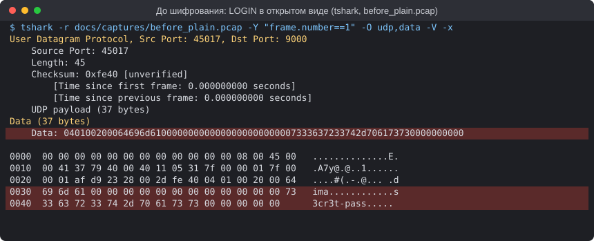
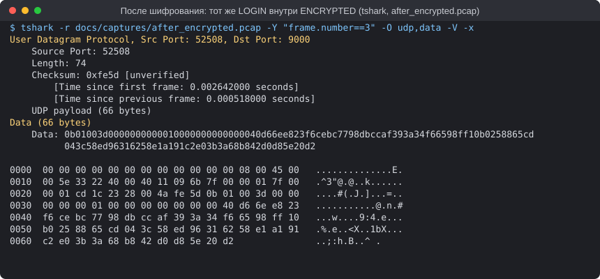

# Security: шифрование UDP-протокола (ПР№6)

Команда: Пройдаков Дмитрий, Петров Артем, Бухальцев Павел. Ветка `feature/encryption`.

Код: [`src/`](../src) (C++17, OpenSSL 3). Проверки: [`tools/run_scenarios.sh`](../tools/run_scenarios.sh).
Логи всех тестов: [`evidence/`](evidence). Записи трафика для Wireshark: [`captures/`](captures).

## 1. Модель угроз

**Кто атакует.**

| Атакующий | Возможности | Пример |
|---|---|---|
| Пассивный сниффер | видит все датаграммы между клиентом и сервером | общий Wi-Fi, провайдер, Wireshark на соседней машине |
| Активный MITM | видит, изменяет, удаляет, повторяет и подделывает датаграммы | злоумышленник на маршруте, ARP-spoofing в локальной сети, свой прокси |
| Внешний атакующий без доступа к каналу | шлёт произвольные UDP-пакеты на сервер, может подделать IP отправителя | флуд, перебор, DDoS по origin |

**Что защищаем.**

| Данные | Угроза без защиты | Чем закрыто |
|---|---|---|
| Логин и пароль (`LOGIN`) | пароль читается из пакета — видно на снимке «до» | конфиденциальность AES-256-GCM |
| Команды движения (`MOVEMENT`) | чтение позиции (wallhack по трафику), подмена координат | шифрование + тег GCM |
| Выстрелы (`SHOOT`) | подмена направления/оружия, повтор выстрела | тег GCM + окно повторов |
| Номер и тип пакета (заголовок) | подмена `seq`/`type`/`payloadSize` | заголовок входит в AAD: открыт, но аутентифицирован |
| Подтверждения сервера (`ACK`) | подделка подтверждения, отражение ответа серверу | шифрование, отдельное пространство счётчиков сервера |

**Вне рамок работы:** DDoS на сам origin (закрывается Cloudflare Spectrum и файрволом, см.
[Cloudflare_Spectrum_Setup.md](Cloudflare_Spectrum_Setup.md)), читы на клиенте и анализ размеров и
времени пакетов (длина шифртекста равна длине открытого текста + 29 байт).

## 2. Скриншоты Wireshark

Трафик записан `tcpdump` на интерфейсе loopback в контейнере Linux (на Windows для этого нужен Npcap),
фильтр `udp.port == 9000`. Записи лежат в [`captures/`](captures) и открываются в Wireshark.
Ниже — тот же пакет `LOGIN` в выводе tshark (консольного Wireshark): поле **Data** и байты пакета.

| До шифрования (`before_plain.pcap`, кадр 1) | После шифрования (`after_encrypted.pcap`, кадр 3) |
|-|-|
|  |  |

> Скриншоты окна Wireshark GUI: открыть [`captures/before_plain.pcap`](captures/before_plain.pcap) и
> [`captures/after_encrypted.pcap`](captures/after_encrypted.pcap), фильтр `udp.port == 9000`, выделить
> кадр, сохранить как `screenshots/wireshark_before.png` и `screenshots/wireshark_after.png`.

**Что видно в поле Data до и после.**

* **До:** `04 01 00 20 00 | 64 69 6d 61 … | 73 33 63 72 33 74 2d 70 61 73 73 …` — тип `LOGIN`, номер пакета,
  размер, а в ASCII-колонке прямо читаются логин `dima` и пароль `s3cr3t-pass`. Пакеты движения содержат
  координаты как `float` (`00 00 80 3f` = 1.0), выстрел — номер оружия и направление. Всё это можно
  прочитать и изменить. Полный дамп: [`evidence/01_plain_wireshark.txt`](evidence/01_plain_wireshark.txt).
* **После:** открыты только 5 байт заголовка (`0b 01 00 3d 00` — `ENCRYPTED`, seq = 1, размер 61) и nonce
  (`00 00 00 00 | 01 00 00 00 00 00 00 00` — счётчик пакета 1). Дальше 33 байта шифртекста и 16 байт тега,
  неотличимые от случайных. Даже внутренний тип команды (логин, движение или выстрел) скрыт.
  Полный дамп: [`evidence/02_encrypted_wireshark.txt`](evidence/02_encrypted_wireshark.txt).

| Пакет | Открытый UDP payload | Зашифрованный UDP payload |
|---|---|---|
| LOGIN | 37 байт | 66 байт |
| MOVEMENT | 17 байт | 46 байт |
| SHOOT | 14 байт | 43 байт |
| ACK сервера | 5 байт | 36 байт |

Накладные расходы — 29 байт на пакет: nonce 12 + тег 16 + внутренний тип 1.

## 3. Схема обмена ключами

```
 Клиент                                                     Сервер (std::map<"ip:port", Session>)
 GenerateKeyPair() → (c, C = c·G)                           
 ── KEY_EXCHANGE {type=10, seq=0, size=32} | C ──────────►  GenerateKeyPair() → (s, S = s·G)
                                                            [--sign-key] sig = Ed25519(«game-udp-v1/handshake» ‖ C ‖ S)
 ◄────────────── KEY_EXCHANGE {type=10, size=32|96} | S [| sig]
 [--pin] проверить sig открытым ключом сервера
 X25519(c, S) = общий секрет = X25519(s, C)
 HKDF-SHA256(секрет, info = "game-udp-v1") → ключ сессии 32 байта (обе стороны)
 общий секрет стирается (OPENSSL_cleanse)
 ── ENCRYPTED {type=11, seq, size} | nonce(счётчик клиента) | ct | tag ─►  сессия по адресу → расшифровка
 ◄─ ENCRYPTED {type=11, seq, size} | nonce(счётчик | 2⁶³) | ct | tag ───  ответ своим счётчиком
```

1. Клиент создаёт эфемерную пару X25519 и отправляет `KEY_EXCHANGE` с 32 байтами открытого ключа.
   Пакет теряется — клиент повторяет его (до 3 попыток с тайм-аутом 1 с).
2. Сервер создаёт свою эфемерную пару, вычисляет ключ сессии и сохраняет его в таблице сессий по адресу
   клиента (UDP не имеет соединений). Отвечает `KEY_EXCHANGE` со своим открытым ключом, а при
   `--sign-key` добавляет подпись Ed25519 транскрипта.
3. Клиент проверяет подпись (если задан `--pin`) и вычисляет тот же ключ сессии.
4. Дальше все игровые пакеты идут как `ENCRYPTED`. Эфемерные ключи после рукопожатия освобождаются,
   поэтому утечка ключа одной сессии не раскрывает другие (forward secrecy).

## 4. Выбранные алгоритмы и обоснование

- **Обмен ключами: X25519.** Диффи–Хеллман на кривой Curve25519: 32-байтные ключи (помещаются в один
  маленький пакет), быстрые операции, нет «слабых» параметров, которые нужно проверять, как в классическом DH.
- **Вывод ключа: HKDF-SHA256.** Общий секрет X25519 — это точка кривой, а не равномерно случайный ключ.
  HKDF превращает его в ключ AES нужной длины, а метка `info = "game-udp-v1"` разделяет ключи разных
  протоколов и версий.
- **Шифрование: AES-256-GCM.** Почему GCM, а не CBC:
  * GCM — **аутентифицированное** шифрование (AEAD): тег 16 байт ловит любое изменение шифртекста, nonce
    или заголовка. CBC даёт только конфиденциальность: подмену байта сервер не заметит, а без отдельного
    HMAC возможны атаки на паддинг (padding oracle).
  * **AAD:** заголовок остаётся открытым (сервер читает тип и номер до расшифровки), но защищён тегом.
  * Нет паддинга: шифртекст равен по длине открытому тексту, что важно для маленьких игровых пакетов.
  * Работает в режиме счётчика: каждый пакет расшифровывается независимо, без цепочки блоков между
    пакетами — подходит для UDP, где пакеты теряются и переупорядочиваются. Есть аппаратное ускорение (AES-NI).
- **Аутентификация сервера (доп.): Ed25519.** Короткая подпись (64 байта) транскрипта рукопожатия,
  открытый ключ сервера закрепляется в клиенте (`--pin`).

**Nonce.** 12 байт: `00 00 00 00 | счётчик отправителя (8 байт)`. У клиента счётчик 1, 2, 3, …,
у сервера — тот же счётчик с установленным старшим битом. Ключ сессии общий для двух направлений,
поэтому без разделения сервер и клиент выдали бы одинаковый nonce для своих первых пакетов.

## 5. Формат зашифрованного пакета

| Поле | Размер | Шифруется | Аутентифицируется |
|-|-|-|-|
| Header (type = 11, seq, payloadSize) | 5 | нет | да (AAD) |
| Nonce (0000 + счётчик отправителя) | 12 | нет | да (входит в вычисление GCM) |
| Payload: внутренний тип (LOGIN/MOVEMENT/SHOOT/ACK) + тело | 1 + N | да | да |
| Tag | 16 | - | - (сам является проверкой) |

`payloadSize` = 12 + 1 + N + 16 и заполняется **до** шифрования, потому что заголовок целиком входит в AAD.

## 6. Тесты

Все тесты воспроизводятся одной командой (контейнер Ubuntu 24.04, OpenSSL 3):

```bash
docker build -t pr6-env -f tools/Dockerfile tools
docker run --rm -v "$PWD:/work" pr6-env bash tools/run_scenarios.sh
```

Модульные проверки [`crypto_test`](../src/crypto_test.cpp): **24 из 24 OK**
([`evidence/00_crypto_test.txt`](evidence/00_crypto_test.txt)) — совпадение ключей, расшифровка, подмена
шифртекста/nonce/тега/заголовка, обрезанный пакет, чужой ключ, уникальность 1000 nonce, разделение
счётчиков клиента и сервера, окно повторов, подпись рукопожатия.

Сетевые сценарии через MITM-прокси [`tools/udp_mitm.py`](../tools/udp_mitm.py):

- [x] **Корректный обмен проходит.** Рукопожатие, затем LOGIN, 4 MOVEMENT, 2 SHOOT: 7 из 7 ответов
  расшифрованы ([`02_encrypted.txt`](evidence/02_encrypted.txt)).
- [x] **Подмена байта шифртекста отклоняется.** Прокси инвертирует младший бит байта №18 (считая с нуля: первый байт шифртекста после
  заголовка, nonce и внутреннего типа) в пакете seq = 3.
  Сервер: `AUTH_FAIL seq=3`, пакет отброшен, у клиента тайм-аут только этого пакета, остальные 6 проходят
  ([`04_tamper.txt`](evidence/04_tamper.txt)).
- [x] **Повтор старого пакета (replay).** Прокси отправляет пакет seq = 3 ещё раз сразу и через 0,5 с.
  Результат: шифртекст корректный, тег сходится, поэтому сам GCM повтор **не** ловит. Обработка: сервер
  хранит окно последних 64 счётчиков клиента (как в IPsec/DTLS) и отбрасывает оба повтора до
  расшифровки: `REPLAY seq=3 counter=3 — отброшен` ([`05_replay.txt`](evidence/05_replay.txt)).
  Окно сдвигается только после успешной проверки тега, поэтому поддельный пакет с большим счётчиком
  не может «закрыть» окно для честных пакетов.
- [x] **Отражение ответа сервера (reflection).** Ответ сервера зашифрован тем же ключом сессии, и без
  защиты сервер принял бы его как пакет клиента. Счётчик со старшим битом выдаёт его:
  `REFLECT … counter=0x8000000000000001 — отброшен` ([`06_reflect.txt`](evidence/06_reflect.txt)).
- [x] **Открытые пакеты отклоняются**, если сервер не запущен с `--allow-plain`
  ([`03_plain_rejected.txt`](evidence/03_plain_rejected.txt)).
- [x] **MITM на голом DH удаётся** — см. раздел 7 ([`07_dh_mitm.txt`](evidence/07_dh_mitm.txt)).
- [x] **MITM при подписанном рукопожатии обнаружен**: `handshake REJECTED`
  ([`08_dh_mitm_signed.txt`](evidence/08_dh_mitm_signed.txt)), без атакующего подписанное рукопожатие
  работает ([`09_signed_ok.txt`](evidence/09_signed_ok.txt)).

### Ошибки, найденные в выданном каркасе

Каркас сначала был собран и запущен без изменений (коммит `chore: practice 6 skeleton`):

| Ошибка | Последствие | Исправление |
|---|---|---|
| `payloadSize` в заголовке заполнялся **после** `EncryptAES`, а заголовок — это AAD | при шифровании AAD содержал `payloadSize = 0`, при расшифровке — настоящий размер; **каждый** пакет давал `AUTH_FAIL`, клиент получал 5 тайм-аутов из 5 | размер вычисляется заранее (`12 + len + 16`) и записывается до шифрования — в клиенте и сервере |
| После `AUTH_FAIL` стоял `continue` без `fflush` | сообщения об отклонённых пакетах не попадали в лог | построчный вывод лога |
| Нет защиты от повторов | перехваченный пакет принимался сервером повторно | `ReplayWindow` на 64 пакета |
| Нет проверки направления | ответ сервера, возвращённый серверу, принимался как пакет клиента | старший бит счётчика сервера проверяется |
| Тип команды угадывался по размеру расшифрованных данных | новые команды того же размера неразличимы | внутренний тип — первый байт открытого текста |
| `payloadSize` не сверялся с фактическим размером датаграммы | | пакет с несовпадающим размером отбрасывается |
| Клиент ждал ответ с любого адреса и не повторял рукопожатие | чужой пакет мог сорвать рукопожатие; потеря одного пакета — отказ | `connect()` на адрес сервера, 3 попытки |

## 7. Известные ограничения

- **Голый DH не защищает от MITM (нет аутентификации сервера).** Открытые ключи ничем не подписаны, и
  клиент не может отличить ключ сервера от ключа атакующего. Это проверено на практике: прокси в режиме
  `dh-mitm` подменяет оба открытых ключа, устанавливает две сессии («клиент — атакующий» и
  «атакующий — сервер»), читает пароль `s3cr3t-pass` и меняет координаты движения на 999.0. Сервер
  принимает подменённые команды, клиент ничего не замечает ([`07_dh_mitm.txt`](evidence/07_dh_mitm.txt)).

  **Как можно исправить** (реализовано как опция): сервер подписывает транскрипт рукопожатия
  (`метка ‖ ключ клиента ‖ ключ сервера`) долговременным ключом Ed25519, а клиент проверяет подпись
  закреплённым открытым ключом (`--pin`, поставляется вместе с клиентом). Атакующий не может подписать
  свой ключ, и клиент обрывает рукопожатие ([`08_dh_mitm_signed.txt`](evidence/08_dh_mitm_signed.txt)).
  Другие варианты: сертификат сервера (TLS/DTLS 1.3 с проверкой цепочки), PSK, выданный при входе через
  HTTPS-API, или протокол Noise (например, `Noise_IK`). На практике проще всего взять готовый DTLS 1.3
  или QUIC, а не собирать протокол самому.
- **Рукопожатие по адресу отправителя.** Злоумышленник, подделавший IP:port клиента, может отправить
  `KEY_EXCHANGE` и перезаписать его сессию (атака на доступность: клиент перестанет получать ответы).
  Исправление: cookie, как в DTLS `HelloVerifyRequest`, и привязка сессии к идентификатору, а не к адресу.
  Число сессий ограничено (`--max-sessions`), чтобы флуд рукопожатиями не исчерпал память.
- **Нет смены ключа.** Счётчик 2⁶³ пакетов на практике не исчерпать, но длинные сессии лучше
  периодически переустанавливать.
- **Метаданные открыты:** размер пакета, время отправки и `seq` видны наблюдателю.
- **Порядок байт** счётчика в nonce — порядок байт платформы (на x86 и ARM — little-endian).
  Для разнородных платформ счётчик нужно явно записывать в сетевом порядке.

## 8. Контрольные вопросы

**Почему в nonce нельзя использовать `rand()`?** В GCM пара «ключ + nonce» не должна повторяться никогда.
`rand()` — некриптографический генератор с маленьким состоянием и часто одинаковым seed. Значения
повторяются или предсказуемы, а даже у хорошего случайного 96-битного nonce вероятность коллизии растёт
с числом пакетов (парадокс дней рождения). При повторе nonce XOR двух шифртекстов равен XOR открытых
текстов, а из двух тегов можно вычислить ключ аутентификации GHASH `H` и подделывать любые пакеты.
Монотонный счётчик гарантирует уникальность и заодно даёт номер пакета для защиты от повторов.

**Что делает атакующий при MITM на голом DH и как это исправить?** Встаёт между клиентом и сервером,
подменяет открытые ключи в обоих `KEY_EXCHANGE` своими и получает два общих секрета. Дальше он
расшифровывает каждый пакет, читает его (пароль), при желании меняет (координаты) и шифрует ключом другой
стороны — обе стороны видят корректные теги. Исправление — аутентифицировать ключ сервера: подпись
транскрипта закреплённым ключом (сделано), сертификат или PSK (раздел 7).

**Зачем закрывать origin для всех, кроме Cloudflare?** Spectrum защищает только трафик, который идёт через
него. Если реальный IP сервера известен (из старых DNS-записей, утечки, сканирования), атакующий бьёт
по origin напрямую, и всё DDoS-фильтрование Cloudflare обходится. Кроме того, сервер с `--spp` доверяет
адресу клиента из заголовка SPP, и прямой доступ позволил бы подделать этот заголовок. Поэтому UDP-порт
VM открыт только для диапазонов Cloudflare ([`tools/origin_firewall.sh`](../tools/origin_firewall.sh)).

**Что видит сервер в адресе отправителя после включения Spectrum и как это влияет на бан по IP?**
В `recvfrom` сервер видит адрес Cloudflare, а не клиента. Это подтверждено эмуляцией
([`evidence/10_spectrum.txt`](evidence/10_spectrum.txt)): все клиенты приходят с адреса прокси. Бан по
этому адресу заблокировал бы всех игроков этого узла Cloudflare. Решение — Simple Proxy Protocol:
Spectrum добавляет к датаграмме 38-байтный заголовок с реальным адресом клиента. Сервер с `--spp`
разбирает его, ведёт сессии и баны по реальному адресу и возвращает тот же заголовок в ответах. В логе
это видно как `[172.30.0.30:58543 via 172.30.0.20:54085]`. Банить по IP имеет смысл только реальный адрес
из SPP, а массовую фильтрацию лучше делать правилами на стороне Cloudflare.
